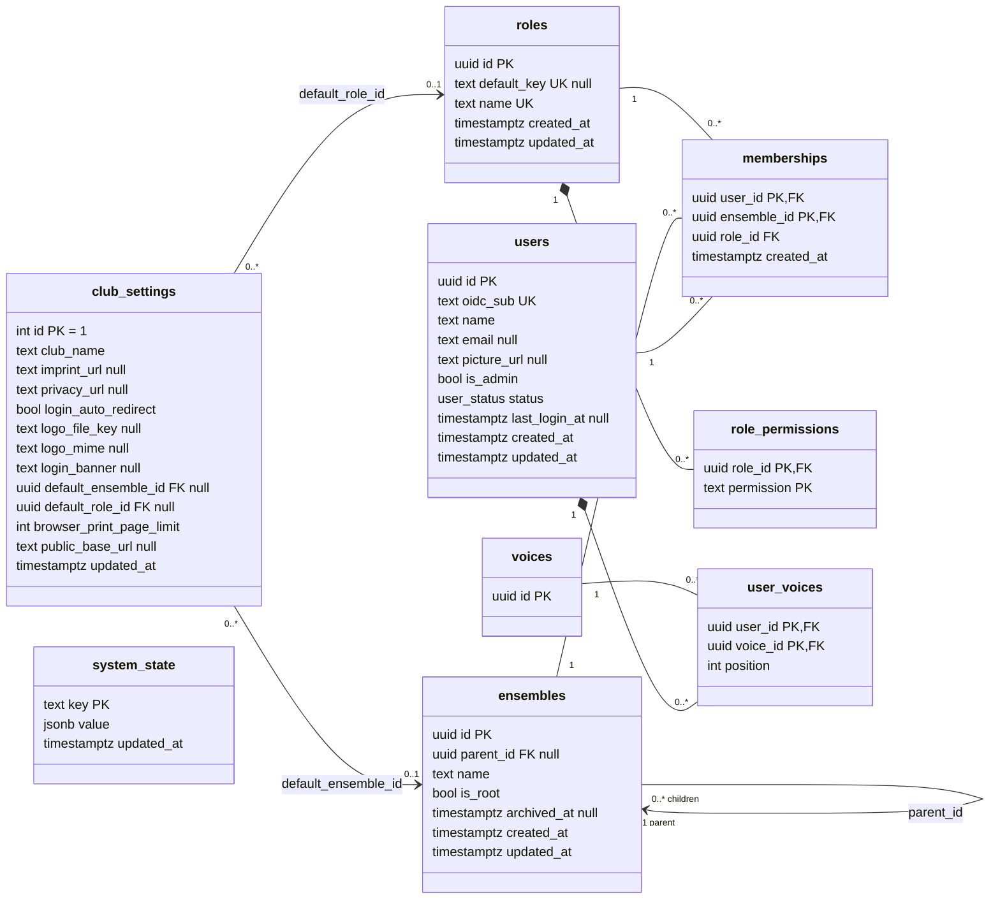
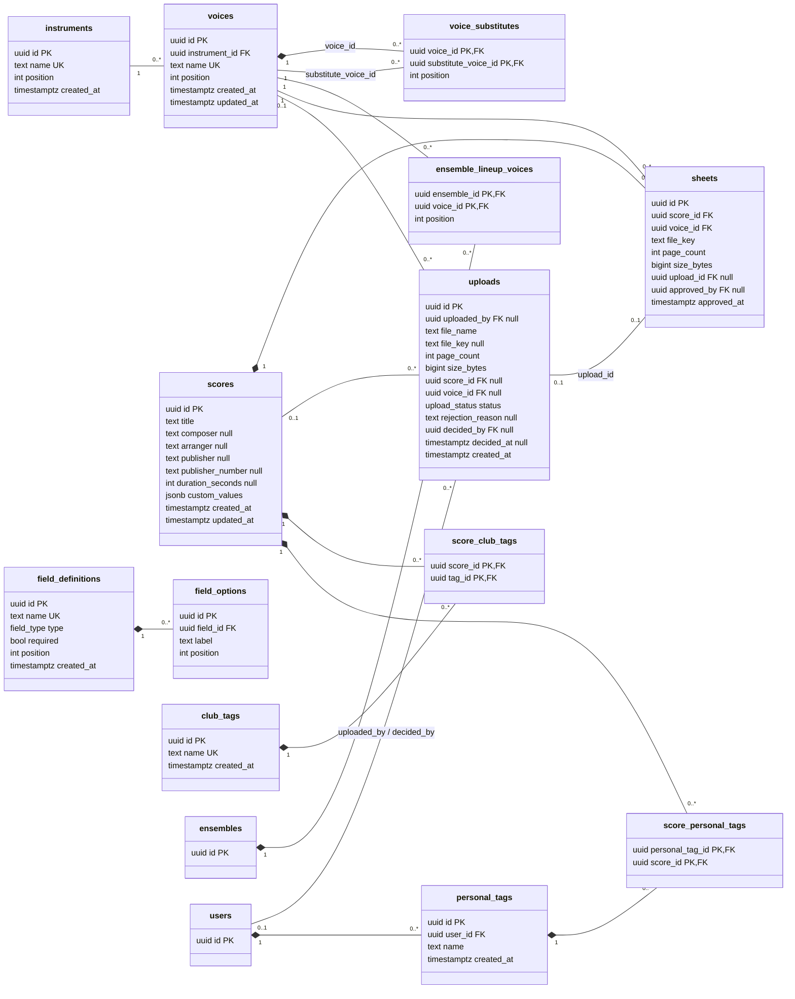
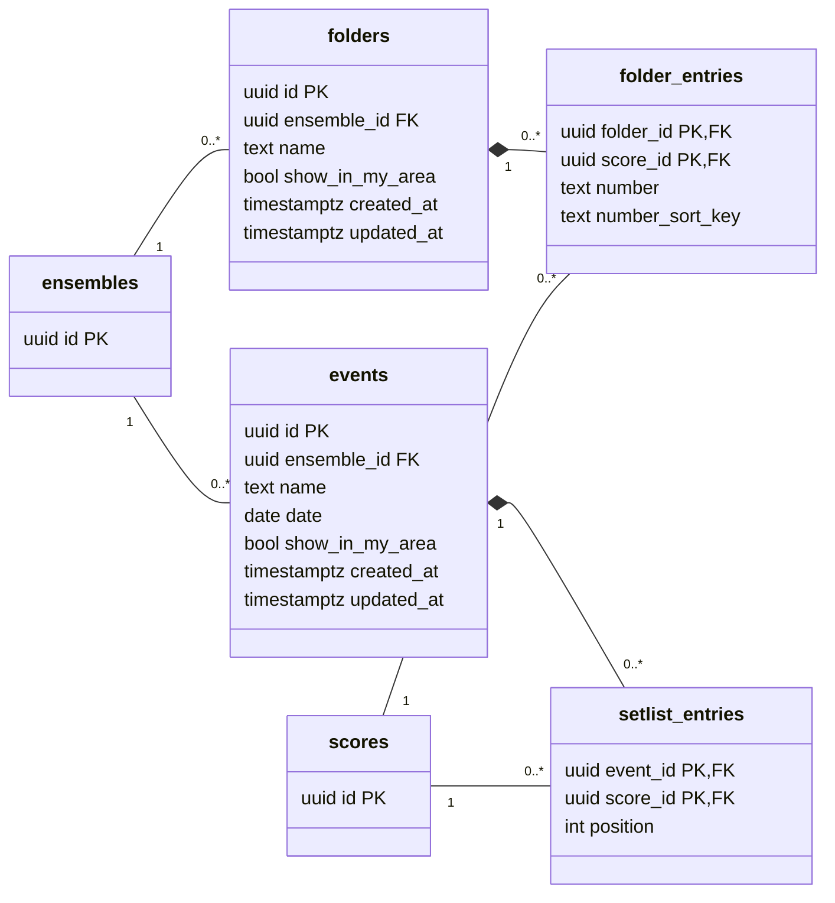

# VM-Web Datenbankschema (Entwurf)

Stand: 2026-11-15 · Status: **Entwurf zur Freigabe** · PostgreSQL 17 mit Drizzle · Grundlage: [api.md](api.md), [requirements.md](requirements.md)

Wird in Scheibe 1 bzw. in den Scheiben, die die Tabellen brauchen, als Drizzle-Schema unter `apps/api/src/db/schema/` umgesetzt.

## Konventionen

- Tabellen und Spalten in `snake_case`, Tabellennamen im Plural. Drizzle-Objekte in `camelCase`.
- Primärschlüssel `id uuid` (UUID v7, in der Anwendung erzeugt). Verbindungstabellen haben zusammengesetzte Primärschlüssel.
- Zeitpunkte `timestamptz`, reine Daten `date`. `created_at`/`updated_at` überall, wo Daten bearbeitet werden.
- Namen, die eindeutig sein müssen, haben einen Unique-Index auf `lower(name)` (Groß-/Kleinschreibung egal).
- Dateien (PDFs, Logo) liegen im `IFileStorage`; in der Datenbank steht nur der `file_key`.
- Sitzungen liegen **nicht** in der Datenbank, sondern im `ICacheService` (vorerst In-Memory).
- Fremdschlüssel: `CASCADE` bei reinen Zuordnungen, `RESTRICT` wo Löschen fachlich verhindert wird (Stimme mit Blättern), `SET NULL` für Personenbezug (Datenschutz-Löschung).

## UML-Klassendiagramm

Legende: `PK` Primärschlüssel, `FK` Fremdschlüssel, `UK` eindeutig, `null` = darf leer sein.

### 1. Benutzer, Ensembles, Rollen, Konfiguration

### 2. Stimmen, Stücke, Blätter, Uploads, Felder, Tags

### 3. Mappen und Events

### Enums

| Enum | Werte |
| --- | --- |
| `user_status` | `active`, `blocked` |
| `upload_status` | `pending`, `approved`, `rejected` |
| `field_type` | `text`, `number`, `date`, `select`, `multiselect`, `link`, `boolean` |

## Tabellen im Detail

### Benutzer, Ensembles, Rollen

| Tabelle | Zweck | Schlüssel, Indizes, Regeln | Anforderungen |
| --- | --- | --- | --- |
| `users` | Konten; Name, E-Mail, Bild kommen bei jedem Login aus den Claims | `oidc_sub` UK; Index `lower(name)`, `lower(email)` für Suche | A-3, A-4, A-5, R-6, S-1 |
| `ensembles` | Ensemble-Baum | `parent_id` → `ensembles.id` `RESTRICT`; genau eine Wurzel: Unique-Partial-Index auf `is_root WHERE is_root`; Check `is_root = (parent_id IS NULL)`; UK `(parent_id, lower(name))`. Zyklen verhindert der Service (Prüfung auf Nachfahren vor `set-parent`) | F-3, S-2 |
| `memberships` | Person in Ensemble mit genau einer Rolle | PK `(user_id, ensemble_id)`; `user_id` `CASCADE`, `ensemble_id` `RESTRICT`, `role_id` `RESTRICT` (Rolle in Benutzung → `409 in-use`) | R-1, F-1 |
| `roles` | benannte Rechtebündel | `default_key` UK (z. B. `admin`, `musician`) für Standardrollen; UK `lower(name)` | R-3, R-5, S-3 |
| `role_permissions` | Rechte einer Rolle | PK `(role_id, permission)`; Check `permission` ∈ Rechte-Codes aus `@vm-web/shared` (bei neuen Codes per Migration erweitert); `CASCADE` | R-3, R-7 |
| `user_voices` | Profilstimmen | PK `(user_id, voice_id)`; `position` für Anzeige; `user_id` `CASCADE`, `voice_id` `RESTRICT` | M-1, S-1 |
| `club_settings` | Konfiguration, genau eine Zeile; `login_banner` ist Klartext (F-12) | Check `id = 1`; `default_ensemble_id` `SET NULL`, `default_role_id` `SET NULL` | S-4, A-2, A-3, D-2, D-4 |
| `system_state` | Ablaufdaten wie „Standardrollen importiert“, „Vorlage importiert“ (Version) | Schlüssel z. B. `seed.roles`, `seed.lineup-template`, `seed.root` | R-5, N-8, S-5 |

Sichtbarkeit in Mein Bereich (H-1): Mappen und Events der Ensembles mit Mitgliedschaft und aller Unter-Ensembles (rekursives CTE nach unten).

Effektive Rechte werden nicht gespeichert, sondern **bei jeder Anfrage** aus drei kleinen Abfragen berechnet (Benutzer, Mitgliedschaften mit Rollenrechten, Ensemble-Baum; `AccessContext` in `apps/api/src/access/`): Rechte pro Ensemble = Vereinigung der Rollen aller Mitgliedschaften in diesem Ensemble und seinen Vorfahren; Vereinsrechte = alle `club`-Rechte aus allen Mitgliedschaften (F-1). Änderungen an Rollen, Mitgliedschaften, Sperren oder am Baum wirken dadurch sofort, ohne Cache-Invalidierung. Falls das bei großen Vereinen zu langsam wird, kann ein Cache im `ICacheService` nachgezogen werden.

### Stimmen, Stücke, Blätter

| Tabelle | Zweck | Schlüssel, Indizes, Regeln | Anforderungen |
| --- | --- | --- | --- |
| `instruments` | Instrumente | UK `lower(name)`; `position` manuell sortierbar, anfangs aus der Besetzungs-Vorlage, neue hinten angehängt | N-6, N-7, F-16 |
| `voices` | Stimmen mit vollem Anzeigenamen | UK `lower(name)`; `instrument_id` `RESTRICT`; `position` innerhalb des Instruments, manuell sortierbar | N-6, N-7, F-16 |
| `voice_substitutes` | geordnete Ersatzstimmen | PK `(voice_id, substitute_voice_id)`; Check `voice_id <> substitute_voice_id`; UK `(voice_id, position)`; beide `CASCADE` | N-9, M-3 |
| `ensemble_lineup_voices` | Besetzung je Ensemble | PK `(ensemble_id, voice_id)`; UK `(ensemble_id, position)`; Ensemble `CASCADE`, Stimme `RESTRICT` | N-4, S-2, N-8 |
| `scores` | Stücke mit festen Feldern | `custom_values jsonb` = `{ "<fieldId>": value }` (GIN-Index); Trigram-Indizes (`pg_trgm`) auf `title`, `composer` für Suche | N-1, N-2, N-3 |
| `field_definitions` | eigene Felder | UK `lower(name)`; `position` | N-2, N-3 |
| `field_options` | Auswahlwerte für `select`/`multiselect` | UK `(field_id, lower(label))`; `CASCADE` | N-2 |
| `sheets` | freigegebenes Notenblatt (ein PDF-Dokument einer Stimme eines Stücks, beliebig viele Seiten) | UK `(score_id, voice_id)` (genau ein Dokument, F-11); Ersetzen tauscht `file_key`/`page_count` in derselben Zeile; `score_id` `CASCADE`, `voice_id` `RESTRICT`, `approved_by` `SET NULL`; `page_count` beim Erzeugen gespeichert | M-2, M-6, N-4, N-12 |
| `uploads` | hochgeladene Dateien bis zur Entscheidung, danach Verlauf | Index `(status, created_at)` für die Warteschlange, `(uploaded_by, created_at)` für „Meine Uploads“; `uploaded_by`/`decided_by` `SET NULL`; `score_id`/`voice_id` `SET NULL`; `file_key` wird 30 Tage nach Entscheidung geleert | N-10 bis N-14, F-2 |
| `club_tags` | Vereins-Tags | UK `lower(name)` | N-17, M-8 |
| `score_club_tags` | Stück ↔ Vereins-Tag | PK `(score_id, tag_id)`; beide `CASCADE` | N-17, M-8 |
| `personal_tags` | persönliche Tags | UK `(user_id, lower(name))`; `user_id` `CASCADE` | M-8 |
| `score_personal_tags` | Stück ↔ persönlicher Tag | PK `(personal_tag_id, score_id)`; beide `CASCADE` | M-8 |

Eigene Felder als `jsonb` statt EAV-Tabelle: Werte werden im Service gegen `field_definitions` validiert (Typ, Pflicht, Option existiert). Sortieren/Filtern läuft über Ausdrücke wie `custom_values->>'<id>'` bzw. `(custom_values->>'<id>')::numeric`. Beim Löschen eines Felds oder einer Option entfernt der Service die Schlüssel bzw. IDs aus allen Stücken (eine `UPDATE`-Anweisung).

### Mappen und Events

| Tabelle | Zweck | Schlüssel, Indizes, Regeln | Anforderungen |
| --- | --- | --- | --- |
| `folders` | Mappen eines Ensembles | `ensemble_id` `RESTRICT`; UK `(ensemble_id, lower(name))`; Index `(ensemble_id, show_in_my_area)` | N-15, R-2 |
| `folder_entries` | Stück in Mappe mit eigener Nummer | PK `(folder_id, score_id)`; UK `(folder_id, number)`; `number_sort_key` = natürliche Sortierung (Zahlen links mit Nullen aufgefüllt), vom Service gesetzt | N-5, M-4 |
| `events` | Events eines Ensembles | `ensemble_id` `RESTRICT`; Index `(ensemble_id, date)` | N-15, N-16, M-5 |
| `setlist_entries` | Setlist | PK `(event_id, score_id)` (jedes Stück einmal); UK `(event_id, position)` `DEFERRABLE INITIALLY DEFERRED` für Umsortieren in einer Transaktion | N-16, M-5 |

## Erster Start (Seed, S-5, R-5, N-8, F-3)

Idempotent in einer Transaktion beim API-Start, gesteuert über `system_state`:

1. Wurzel-Ensemble anlegen (`is_root = true`, Name „Verein“, zunächst ohne Besetzung; später einstellbar, H-4).
2. Standardrollen aus `defaults/roles.default.json` importieren, darunter `admin` mit allen Rechten.
3. `club_settings` (id 1) anlegen: `club_name = 'Verein'`, `browser_print_page_limit = 10`, `default_ensemble_id` = Wurzel, `default_role_id` = `admin` (H-3).
4. Besetzungs-Vorlage (`defaults/lineup.default.json`, Standard-Blasorchester) importieren: Instrumente mit `position`, Stimmen, Ersatzstimmen.
5. Jede neue Anmeldung: Mitgliedschaft im Standard-Ensemble mit Standardrolle (A-3). Erste Anmeldung (`users` leer): zusätzlich `is_admin = true` (H-2). Die Prüfung „erste Person“ läuft mit Sperre (`pg_advisory_xact_lock`), damit bei gleichzeitigen Logins nur eine Person Admin wird.

## Löschen eines Kontos (Datenschutz)

`DELETE FROM users` entfernt per `CASCADE` Mitgliedschaften, Profilstimmen und persönliche Tags samt Zuordnungen. Uploads und Blätter bleiben ohne Namen, `uploaded_by`, `decided_by`, `approved_by` werden `NULL` (Anzeige „Gelöschte:r Benutzer:in“, F-15). Vorher prüft der Service `409 last-admin`.

## Entscheidungen zum Schema

Am 2026-11-15 wie vorgeschlagen entschieden.

| # | Frage | Entscheidung |
| --- | --- | --- |
| D-a | Archivierte Ensembles: Mappen und Events bleiben erhalten, aber wie lange? | Unbegrenzt; Archivieren ist umkehrbar. Endgültiges Löschen eines Ensembles gibt es im MVP nicht. |
| D-b | Soll `scores.custom_values` statt `jsonb` eine eigene Wertetabelle sein (bessere referenzielle Integrität für Optionen)? | `jsonb`; einfacher für Tabelle, Filter und Export, Integrität sichert der Service. |
| D-c | Volltextsuche: reicht `pg_trgm` (Teilwort, tippfehlertolerant), oder braucht es deutsches Stemming (`tsvector`)? | `pg_trgm`; Titel/Komponisten sind Eigennamen. |
